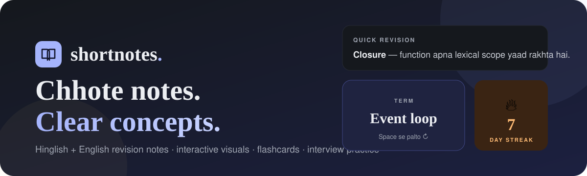
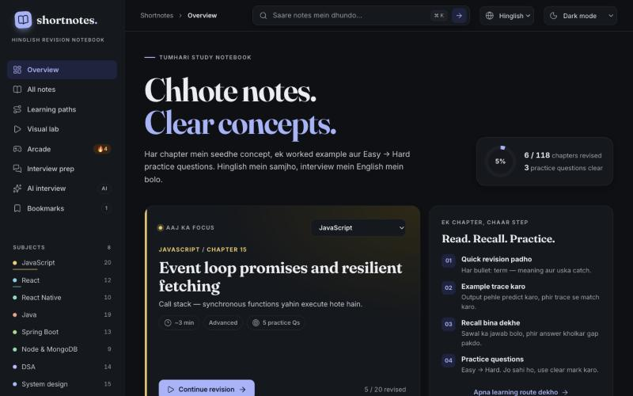
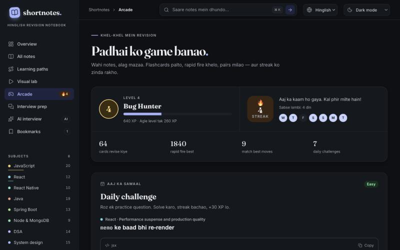
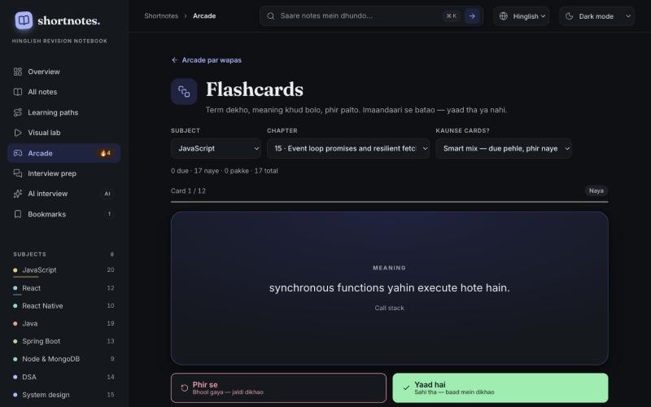
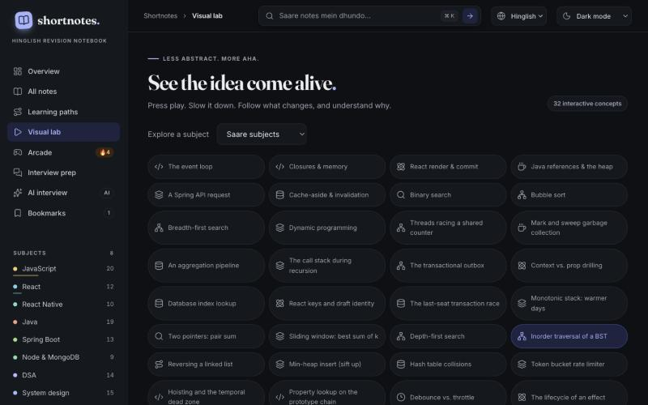
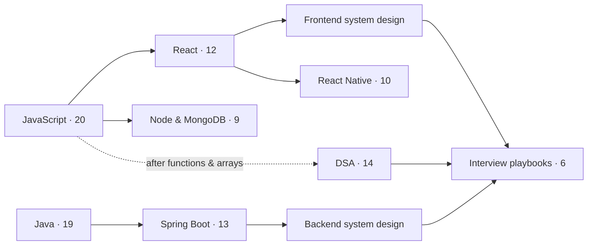
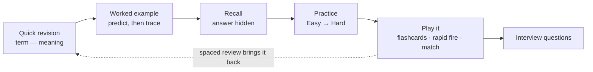

<p align="center">
  
</p>

<p align="center">
  <a href="https://github.com/Siddharth0101/Short-Notes/actions/workflows/check.yml"></a>
</p>

<p align="center">
  <b>English</b> · <a href="#hinglish-mein-poori-jaankari">Hinglish</a> · <a href="notes/README.md">Syllabus</a> · <a href="playground/README.md">App guide</a> · <a href="CONTRIBUTING.md">Contribute</a>
</p>

# Shortnotes — revision notes you actually want to revise

**118 chapters · 598 graded practice questions · 456 interview questions · 37 interactive visuals · 2,400+ flashcards · 3 revision games · English + Hinglish**

Shortnotes is a developer revision notebook for JavaScript, React, React Native, Java, Spring Boot, Node & MongoDB, DSA and system design. Every concept is one line — `term — meaning / important catch` — so you can revise a chapter in minutes, then prove you know it.

| | What you get |
| --- | --- |
| 📝 **Short notes** | 2,405 one-line concepts across 118 ordered chapters, each with a worked example and a recall question whose answer stays hidden until you try. |
| 🎯 **Graded practice** | 5–6 Easy → Hard questions per chapter: output puzzles, find-the-bug, write-the-code and design scenarios. |
| 👀 **Visual lab** | 37 step-by-step visuals — event loop, closures, object references, React render/commit, navigation stacks, Spring proxies, Java streams, SQL query order, BFS/DFS, heaps, hash collisions, token bucket and more. Play, pause, step, change the input. |
| 🎮 **Arcade** | Flashcards with spaced repetition, a timed rapid-fire quiz and a memory-match game — all generated from the same notes. Daily challenge, streaks, XP, levels and 20 badges. |
| 😄 **Desi analogies** | 118 everyday analogies — one for every chapter — ("closure = ghar se mila tiffin") that also say where the analogy breaks. |
| 🎤 **Interview prep** | A 456-question bank with filters, a 15-minute mock session, and an optional one-hour AI interviewer with voice. |
| 🌐 **Two languages** | Switch the whole site between Hinglish and English from the top bar. |
| 📴 **Works offline** | Install it on your phone or desktop. The app opens without internet, chapters you open stay available, and one tap on the Saved page keeps every chapter and interview answer on the device (about 0.4 MB). |
| ⚡ **Light to load** | The app opens with a small chapter list; a subject's notes are fetched when you open one of its chapters, and interview answers when you reach them. |
| 🔗 **Easy to share** | A shared link shows a preview card, every chapter has its own search description, and the build writes a sitemap of all chapters. |
| 🔒 **Yours** | No account. Progress lives in your browser; export and import a backup any time. |

## A quick look

| Dashboard | Arcade |
| --- | --- |
|  |  |
| **Flashcards** | **Visual lab** |
|  |  |

## Pick your route



Each subject has numbered lessons grouped into stages with a checkpoint. Start at Lesson 01 and do the checkpoint before moving on. The [full clickable syllabus](notes/README.md) lists every stage.

## How one chapter works



## Run it

Node.js 22.12+ is required.

```bash
cd playground
npm ci
npm run dev
```

Open the local URL that Vite prints. To validate everything (content checks, translation check, tests, lint and build):

```bash
npm run check
```

## Languages

Pick **Hinglish** or **English** in the top bar; the choice is saved in the browser and follows you across tabs. Hinglish is the canonical text. IDs, section anchors and saved progress are shared, so you can switch mid-chapter without losing anything.

| Part of the site | English | Hinglish |
| --- | --- | --- |
| App interface, arcade, badges, analogies | ✅ complete | ✅ complete |
| Visual lab (37 visuals) | ✅ complete | ✅ complete |
| Course stages, chapter titles and summaries | ✅ 47 stages · 118 chapters | ✅ |
| Full chapter text | ✅ 118 | ✅ 118 |
| Interview question bank (incl. 121 machine-coding tasks) | ✅ 456 | ✅ 456 |

Everything is available in both languages today. If a chapter or question is added later without an English version, it is shown in Hinglish with a short notice, never hidden. English chapters live in [`notes/en/`](notes/en) with the same file names and English interview answers in [`playground/src/data/i18n/questions.en.json`](playground/src/data/i18n/questions.en.json); `npm run i18n:check` verifies that each chapter mirrors its original (same code, sections and practice set) and prints the current coverage. `node scripts/translate-chapters.mjs` and `node scripts/translate-questions.mjs` extract the lines to translate and weave them back, so code never has to be retyped. The check covers structure, not wording — if a sentence reads wrong, the Hinglish original is the reference. See [CONTRIBUTING.md](CONTRIBUTING.md) to add or fix a translation.

## Arcade

| Game | How it works |
| --- | --- |
| **Flashcards** | Every revision bullet is a card. Cards you remember move up a box and come back after 1, 3, 7, 14, then 30 days; a miss sends the card back to box 1. |
| **Rapid fire** | Ten questions: read the meaning, pick the term. Faster answers and combos score more. The timer can be switched off. |
| **Memory match** | Flip tiles to pair six terms with their meanings in as few moves as possible. |
| **Daily challenge** | One practice question a day — the same one for everybody. Solve it to keep your streak. |

XP comes from chapters, practice questions and games. Levels run from *Naya Coder* to *Principal Pandit*. Everything is stored locally and included in the progress backup.

---

## Hinglish mein poori jaankari

- Format — `term — short meaning / important catch`.
- Revision — concept padho, recall karo, weak point repeat karo.

**118 chapters · 598 graded practice questions · 47 course stages · 142 linked source examples · 456 interview questions · 37 interactive visuals · 2,400+ flashcards.**

Shuru karne ke liye [poora syllabus](notes/README.md) kholo. Padhai ka tareeka [study guide](notes/STUDY_GUIDE.md) mein aur difficult terms ke easy meanings [Hinglish glossary](notes/GLOSSARY_HINGLISH.md) mein milenge.

Interview ke liye [52 priority questions aur preparation plan](notes/INTERVIEW_PRIORITY_GUIDE.md) kholo.

**Machine coding practice:** [121 build rounds aur 44 top-priority questions](notes/MACHINE_CODING_PRACTICE.md) — har subject ke 11 rounds, 121 follow-ups, timeboxes, acceptance checks aur answer guides. App mein `machine-coding` search karo.

Har chapter mein quick revision, ek worked example, recall question aur **Easy → Medium → Hard practice questions** (output puzzles, bug-dhundo, code-likho aur design scenarios) hain. Answers pehle hidden rehte hain; app mein jo question sahi ho use "clear" mark karke progress track karo. 8 October 2026 ke pass mein **saare 118 chapters enhance hue; 362 concept points add, ab 2,405 revision points**. Naye additions aur remaining scope ka [repo coverage audit](notes/COVERAGE_AUDIT.md) padho. React Native ka [mobile concept recheck](notes/REACT_NATIVE_REVIEW.md) bhi available hai.

### Kya aur kis order mein padhna hai?

| Course | Chapters | Padhai ka flow |
| --- | ---: | --- |
| JavaScript | 20 | Variables → types/operators → decisions/loops → functions → arrays/objects → scope → browser → OOP → async/tooling → testing → storage/Git |
| React | 12 | JSX/props → state → rendering/identity → composition → effects → routing/shared state → server data/types → performance/practice → behavior testing |
| [React Native](notes/react-native/README.md) | 10 | Expo → native UI/layout → lists → navigation → forms → networking/storage → permissions → performance → testing → release |
| Java | 19 | First program → control flow → classes → packages/interfaces → collections/JVM → builds/tests → SQL → concurrency → type metadata/schema migrations → LLD |
| Spring Boot | 13 | First app → beans/DI → configuration → REST/validation → JPA/security → testing → observability → deployment → jobs/cache → Servlet/MVC → optional AI/RAG |
| Node & MongoDB | 9 | Node/HTTP → Express → documents/CRUD → Mongoose → indexes/query plans → security → production → testing/shutdown |
| DSA | 14 | Complexity → lists/stacks/queues → hashing → search/patterns → recursion/sorting → monotonic stacks → trees/heaps → graphs/DP → greedy/advanced structures |
| System design | 15 | Requirements/scaling → React frontend → Java backend → complete case studies → consistency/limiting → API contracts → OS/network debugging |
| Interview playbooks | 6 | Related course ke baad language, application, algorithm aur design rounds |

Frontend ke liye JavaScript → React → frontend design; mobile ke liye React → React Native follow karo. Backend ke liye Java → Spring Boot → backend design, ya JavaScript → Node/MongoDB route lo. DSA ko apne main track ke saath padh sakte ho. Syllabus mein har stage ke prerequisites aur checkpoint diye hain; beginner ho toh unhe skip mat karo.

### Revision ka format

- Notes — `term — short Hinglish meaning / important catch`.
- Chapters — har subject ke concise concept bullets, practical conditions aur failure cases.
- Code — chapter ka optional examples link kholo jab implementation dekhni ho.
- Recall — chapter ka sawal khud answer karo, jawaab compare karo, phir practice ke acceptance cases verify karo.
- Practice — `## Practice questions` mein 5–6 graded questions; answer `<details>` ke andar hai, isliye GitHub par bhi pehle hidden rehta hai.
- English — saare 118 chapters `notes/en/` mein same file name se hain, stage/chapter titles `notes/en/curriculum.json` aur `notes/en/chapters.json` mein, aur 456 interview answers `playground/src/data/i18n/questions.en.json` mein.

### App chalao

Node.js 22.12+ ya compatible newer supported release chahiye.

```bash
cd playground
npm ci
npm run dev
```

Vite terminal mein jo local URL de, browser mein kholo. Validation aur production preview ke liye:

```bash
npm run check
npm run preview
```

App mein search, numbered syllabus, learning paths, chapter ke previous/next links, bookmarks aur progress milti hai. Source examples related chapter ke andar expand hote hain; kuch examples ke apne interactive playground hain. Search chapter text, source titles/paths aur interview questions mein bhi dhundta hai. Top bar se language (Hinglish/English) aur theme badlo.

### Arcade — khel-khel mein revision

- Flashcards — har revision bullet ek card; "Yaad hai" card ko agle box mein bhejta hai (1, 3, 7, 14, 30 din baad wapas), "Phir se" box 1 mein.
- Rapid fire — 10 sawaal; meaning padhkar sahi term chuno. Timer off bhi kar sakte ho.
- Memory match — 6 terms ko unke meanings se milao.
- Daily challenge — roz ek practice question; solve karke streak bachao.
- XP, levels aur 20 badges — sab isi browser mein save; Bookmarks ke backup mein bhi shamil.
- Desi analogies — har chapter (118) ke liye yaad rakhne wala example, har ek ke saath "analogy ki limit".

### Live AI interviewer

Subject choose karke one-hour interview practice karo: self-introduction, project follow-ups, theory, machine coding, hints, aur final review. Gemini speech-recognition aur text-to-speech tools ke saath voice aur typed answers dono available hain. Browser sirf mic capture aur audio playback karta hai.

Root se `npm ci --prefix server` chalao. MongoDB ke liye root `.env` mein `MONGODB_URI` aur `MONGODB_DB=shortnotes` set karo; purani sessions import karne ke liye server stop karke `playground/` se `npm run db:migrate` chalao. Root `.env` mein server-only `GEMINI_API_KEY` set karo (`.env.example` dekho; existing `.env` overwrite mat karo). Default model `gemini-3.5-flash-lite` hai. Phir:

```sh
cd playground
npm run dev:agent
```

Open `http://127.0.0.1:5173/interview/live`. Session configured MongoDB mein save hoti hai (URI absent ho toh local JSON); pause karke baad mein continue kar sakte ho. Submitted code execute nahi hota. Yeh local single-user setup hai; public deployment ke liye backend authentication aur durable shared storage add karna hoga.

[Setup, hub/specialist architecture, tools, memory, aur limitations](docs/INTERVIEWER_ARCHITECTURE.md) padho. Existing notes, arcade aur self-review practice AI ke bina bhi chalti hain.

Progress isi browser ke local storage mein rehti hai. **Bookmarks** se JSON export karke backup rakho; doosre device par import karke merge kar sakte ho. Backup mein arcade ke stats (XP, streak, flashcard boxes, badges) bhi aate hain. Account ya automatic server sync nahi hai. Site data clear karne se local progress delete ho jaati hai. Purane source links owning chapter par redirect hote hain; source bookmarks migrate hote hain. Sirf source complete karne se poora chapter complete mark nahi hota.

### Interview practice aur visuals

[Answered workbook](notes/INTERVIEW_WORKBOOK.md) offline revision ke liye hai. App mein subject, topic aur difficulty filters, related reading, hidden answers aur follow-ups hain. Five-question mock session mein 15-minute pausable timer, talking-point drafts aur self-review milta hai. Session chhodne par temporary mock drafts clear ho jaate hain.

Supplied checklist se 104 questions add hue aur 13 existing answers examples ke saath expand hue. Repeated topics same canonical question se linked hain. Workbook mein corrected premises aur supplied flexbox images ke original code solutions bhi hain. Practice scenarios kisi specific company mein poochhe jaane ka claim nahi karte.

37 visuals mein event loop, closures, hoisting/TDZ, prototype chain, object reference vs copy, debounce vs throttle, React render/commit, effect lifecycle, Context, keys, Java references, streams pipeline, synchronization, GC, Spring proxy, SQL query order, navigation stack, request flow, caching, outbox, token bucket, binary search, two pointers, sliding window, sorting, BFS, DFS, tree traversal, linked-list reversal, heap insert, hash collisions, recursion, DP, Mongo indexes/aggregation, transaction race aur monotonic stack cover hote hain. Step controls, playback, reset aur speed se apni pace par dekho. Simplified model ki limits takeaway mein padho.

### Repo ka map

```text
examples/                  Optional chapter code snippets
notes/                     Short Hinglish revision chapters
  README.md                Poora clickable syllabus
  STUDY_GUIDE.md            Quick revision routine
  GLOSSARY_HINGLISH.md      Terms ke easy meanings aur examples
  COURSE_COVERAGE.md        Topic mapping aur coverage ki limits
  INTERVIEW_WORKBOOK.md     Questions, answers aur follow-ups
  en/                       English chapters, stage names aur chapter titles
01_JavaScript/             Original source examples aur slides
02_Dsa/                    DSA source examples
03_Frontend/               HTML/CSS aur React references
04_Backend/                Node, SQL, MongoDB, Java aur slides
05_Interview/              Existing playgrounds aur references
06_System_Design/          System-design references
playground/                React + Vite app aur tests
  src/play/                 Arcade: flashcards, rapid fire, memory match
  src/i18n/                 UI strings — Hinglish aur English
scripts/                   Syllabus/workbook generators aur content checks
docs/                      Interviewer architecture aur README assets
```

Numbered folders ke original source files aur PDF slides reference material hain; PDF pages ko Hinglish mein rewrite nahi kiya gaya. Structured learning material `notes/` aur app ke course/interview sections mein padho.

### References aur coverage

[Primary source map](notes/RESEARCH_SOURCES.md) mein official references hain; September 2026 ke external comparison aur React Native additions bhi linked hain. Sources mein MDN, React, TypeScript, Java, Spring, PostgreSQL, Node, MongoDB aur doosri primary documentation hai. Exact links chapters mein diye hain.

Course routes Jonas Schmedtmann ke JavaScript/React/Node-MongoDB, Telusko ke Java aur Colt Steele ke DSA topics ke original companions hain. Instructor names reference context hain; affiliation ka claim nahi. Exact enrolled editions aur complete lecture lists available nahi the, isliye broad topic coverage ko verified every-lecture reproduction mat samjho. [Coverage guide](notes/COURSE_COVERAGE.md) mein mapping aur lecture audit ki limits hain.

App architecture ke liye [app guide](playground/README.md), aur content add karne ke liye [contribution guide](CONTRIBUTING.md) padho.
